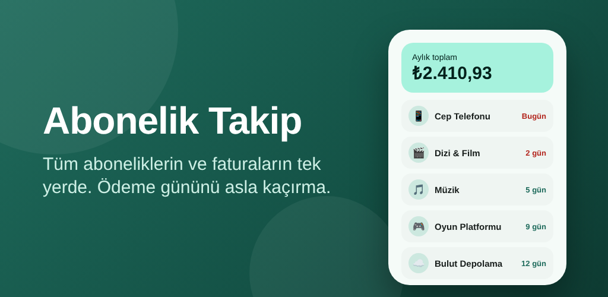

# Abonelik Takip

[](https://github.com/burhanettiny/abonelik-takip/actions/workflows/android.yml)

Dizi-film platformları, müzik, telefon ve internet faturası, kira, sigorta gibi **düzenli ödemeleri takip eden**,
ödeme gününden önce **hatırlatan** ve aylık/yıllık harcamayı **analiz eden** Android uygulaması.

Tamamen çevrimdışı çalışır: hesap yok, reklam yok, internet izni yok. Veriler yalnızca cihazda saklanır.

<p align="center">
  
</p>

## Özellikler

| Alan | Ayrıntı |
|---|---|
| Abonelikler | Ekleme, düzenleme, silme, duraklatma; not ve 12 kategori |
| Ödeme sıklığı | Haftalık, aylık, 3 aylık, 6 aylık, yıllık |
| Tarih hesabı | Sonraki ödeme otomatik hesaplanır; ay sonu ve 29 Şubat doğru işlenir |
| Hatırlatma | Aynı gün / 1, 2, 3 gün / 1 hafta önce; saat ayarlanabilir; tekrar etmeyen bildirim |
| Özet | Aylık, yıllık, önümüzdeki 30 gün; aktif abonelik sayısı |
| Analiz | Para birimine göre halka grafik, kategori dağılımı, en pahalı 5, günlük ortalama |
| Liste | Önümüzdeki 7 gün / 30 gün / Daha sonra / Duraklatılanlar bölümleri; sıralama ve kategori filtresi |
| Para birimleri | TRY, USD, EUR, GBP (her biri ayrı toplanır) |
| Veriler | JSON yedekleme / geri yükleme (ekle veya değiştir), tüm verileri silme, Android otomatik yedekleme |
| Görünüm | Material 3, açık/koyu/sistem teması, Android 12+ dinamik renk, kenardan kenara ekran |
| Dil | Türkçe ve İngilizce; Android 13+ uygulama başına dil seçimi |

## Mimari

```
app/src/main/java/com/aboneliktakip/app/
├── AboneApp.kt / AppContainer.kt   Uygulama sınıfı ve basit bağımlılık kabı
├── MainActivity.kt                 Tema, kenardan kenara, bildirim izni, bildirimden derin bağlantı
├── data/                           Room: Subscription varlığı, DAO, veritabanı
├── settings/                       DataStore tabanlı ayarlar
├── domain/                         Saf Kotlin iş mantığı (birim testli)
│   ├── Billing.kt                  Ödeme tarihi hesapları
│   ├── Overview.kt                 Bölümler, sıralama, istatistikler
│   ├── Format.kt                   Para/tarih biçimlendirme, TR+EN tutar ayrıştırma
│   └── Backup.kt                   JSON yedek biçimi
├── notify/                         WorkManager ile günlük hatırlatma, bildirimler
└── ui/                             Jetpack Compose ekranları (home, edit, stats, settings)
```

- **Kotlin 2.4**, **Jetpack Compose** (Material 3), **Navigation Compose**
- **Room** (KSP) · **DataStore** · **WorkManager**
- **AGP 9.5**, Gradle 9.8, minSdk 26 · targetSdk 36 · compileSdk 37
- R8 küçültme ve kaynak daraltma açık

## Geliştirme

1. Depoyu klonlayın ve **Android Studio**'da açın (`File > Open`).
2. Gradle senkronizasyonu bitince emülatör veya USB hata ayıklaması açık bir telefon seçip **Run ▶**'a basın.

```bash
./gradlew testDebugUnitTest
```

```bash
./gradlew lintRelease
```

```bash
./gradlew assembleDebug
```

Debug sürümü `com.aboneliktakip.app.debug` paket adıyla kurulur, yani mağaza sürümüyle yan yana çalışabilir.
Örnek verilerle denemek için:

```bash
adb shell am start -n com.aboneliktakip.app.debug/com.aboneliktakip.app.MainActivity --ez demo_seed true --es demo_route home
```

## CI / CD

| İş akışı | Tetikleyici | Ne yapar |
|---|---|---|
| `android.yml` | Her push / PR | Birim testleri, lint, debug APK, release AAB |
| `release.yml` | `v*` etiketi | İmzalı AAB + APK, imza doğrulama, GitHub Release |
| `screenshots.yml` | Elle | Emülatörde TR/EN, açık/koyu mağaza ekran görüntüleri |

## Yayınlama

Play Store'a yükleme adımlarının tamamı ve Play Console formlarının hazır cevapları:
**[docs/YAYINLAMA.md](docs/YAYINLAMA.md)**

- Mağaza metinleri ve görselleri: [`fastlane/metadata/android/`](fastlane/metadata/android/)
- Gizlilik politikası: https://burhanettiny.github.io/abonelik-takip/privacy.html

## Yol haritası

- [ ] Ana ekran widget'ı (Glance)
- [ ] Döviz kuruyla tek para biriminde toplam
- [ ] Deneme süresi (free trial) bitiş hatırlatması
- [ ] Ödeme geçmişi ve "ödendi" işaretleme
- [ ] Pro sürüm (uygulama içi satın alma)
